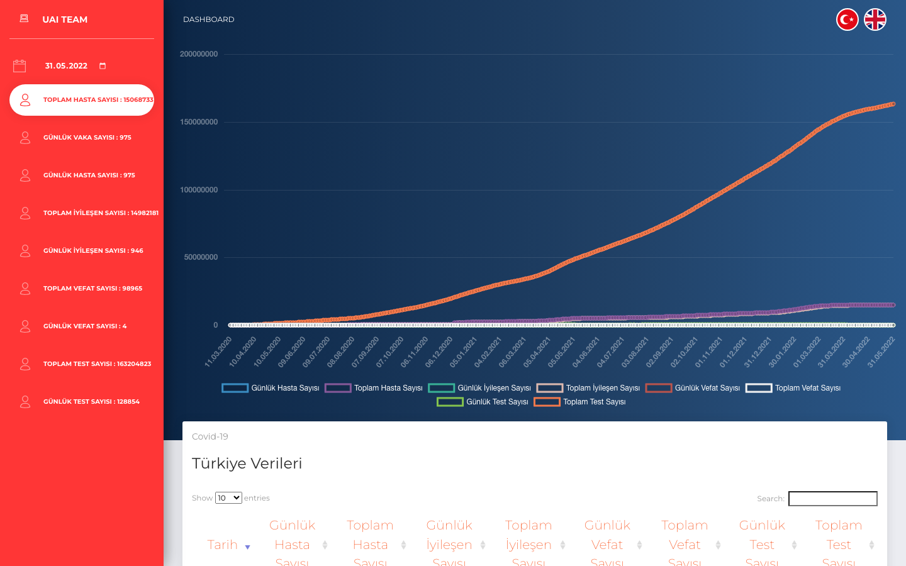
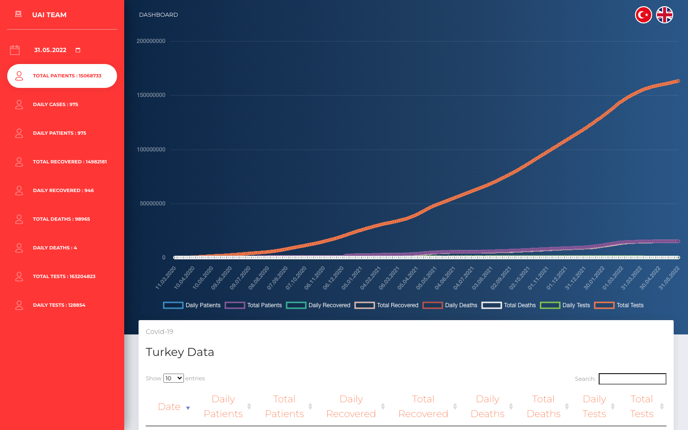

**Language:** [Türkçe](README.md) | English

# uai-covid19-tur

A Flask dashboard for Turkey's daily COVID-19 time series. It produces short-horizon forecasts with Holt's method, simple exponential smoothing, and polynomial regression.

## Screenshots

Default Turkish UI. The sidebar shows summary counts and a date picker; circular flags in the top-right switch the language:



English UI. Labels and chart legends switch to English; the selected date is kept:



## Features

- Turkish is the default language; circular flags in the top-right switch the UI to English.
- The calendar under UAI Team loads the series from the first data day up to the selected date (with a loading spinner).

## Data

Coverage: **11 March 2020 – 31 May 2022** (the last day of the Ministry of Health daily table). From 1 June 2022 the ministry published weekly figures only, so the rest of 2022 is not in the daily series.

Source: [ozanerturk/covid19-turkey-api](https://github.com/ozanerturk/covid19-turkey-api) (compiled from the ministry table). After 5 July 2021 the “patients” column stopped being published, so that series uses daily cases from that date onward; cumulative totals are completed from the daily increments.

## Requirements

- Python 3.10+
- pip

## Setup

```bash
python3 -m venv .venv
source .venv/bin/activate
pip install -r requirements.txt
```

## Run

Development:

```bash
python app.py
```

Browser: [http://127.0.0.1:5002](http://127.0.0.1:5002)

English: [http://127.0.0.1:5002/?lang=en](http://127.0.0.1:5002/?lang=en)

Production-style:

```bash
gunicorn --bind 127.0.0.1:5002 app:app
```

## Tests

```bash
pytest
```

## Project layout

| File | Role |
| --- | --- |
| `app.py` | Flask entry point, language and date parameters |
| `i18n.py` | Turkish / English copy |
| `dataset.py` | CSV loading, date slice, column reconstruction |
| `forecasts.py` | Holt / SES / polynomial forecasts |
| `data/COVID.csv` | 812-day historical series |
| `templates/dashboard.html` | Charts and tables |
| `docs/screenshots/` | README screenshots |
| `tests/` | Data, language, date, and page tests |
