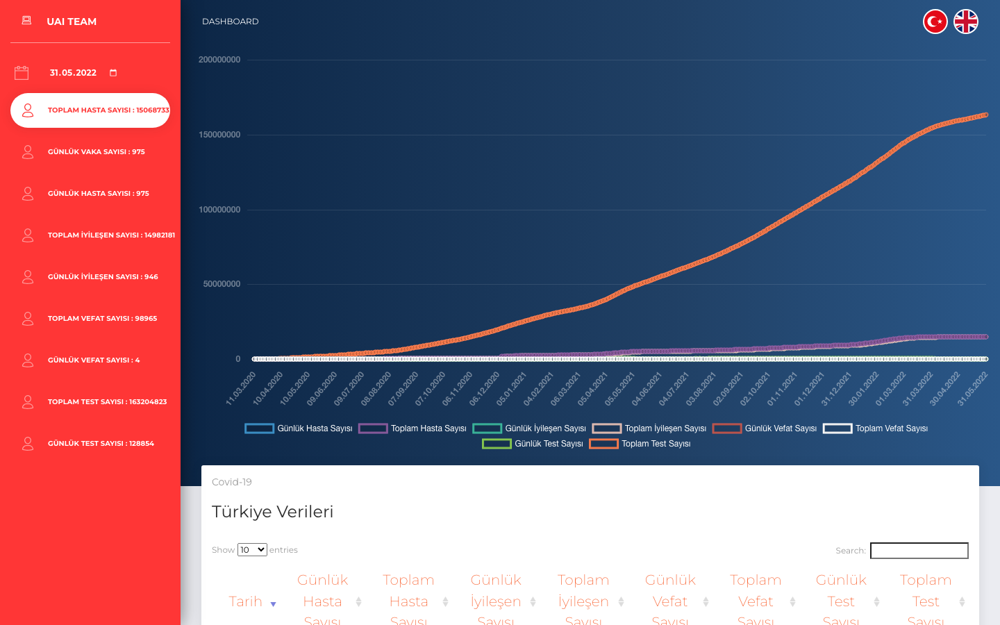
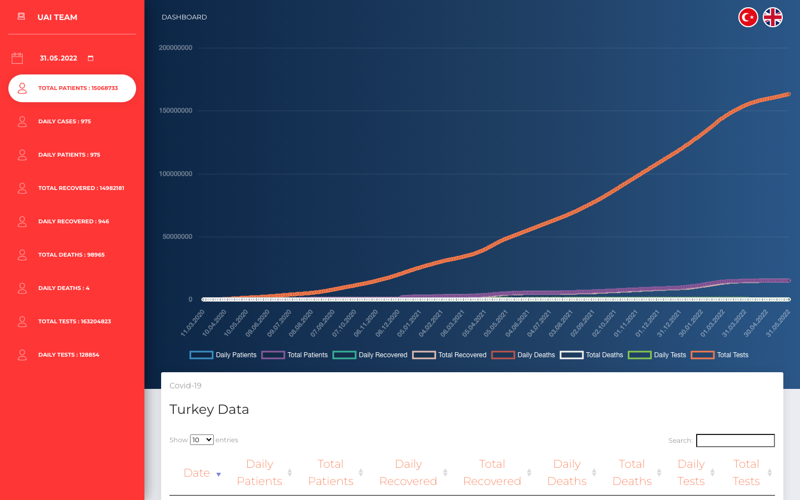

**Dil:** Türkçe | [English](README.en.md)

# uai-covid19-tur

Türkiye COVID-19 günlük serilerini gösteren Flask dashboard'u. Holt, basit üstel düzleştirme ve polinom regresyon ile kısa vadeli tahmin üretir.

## Ekran görüntüleri

Türkçe arayüz (varsayılan). Sol menüde özet sayılar ve tarih seçici, sağ üstte yuvarlak bayraklarla dil değiştirme:



İngilizce arayüz. Metinler ve grafik etiketleri İngilizceye döner; seçili tarih korunur:



## Özellikler

- Varsayılan dil Türkçe; sağ üstteki yuvarlak bayraklarla İngilizceye geçilir.
- UAI Team altındaki takvim, ilk veri tarihinden seçilen güne kadar olan kesiti yükler (yükleme animasyonu ile).

## Veri

Veri aralığı: **11 Mart 2020 – 31 Mayıs 2022** (Sağlık Bakanlığı günlük tablosunun son günü). 1 Haziran 2022'den sonra açıklamalar haftalığa geçtiği için 2022'nin geri kalanı günlük seride yok.

Kaynak: [ozanerturk/covid19-turkey-api](https://github.com/ozanerturk/covid19-turkey-api) (bakanlık tablosundan derlenmiş). 5 Temmuz 2021'den sonra "hasta" kolonu yayımlanmayı bıraktığı için o tarihten itibaren günlük hasta serisinde vaka sayısı kullanılır; kümülatif toplamlar günlük artışlarla tamamlanır.

## Gereksinimler

- Python 3.10+
- pip

## Kurulum

```bash
python3 -m venv .venv
source .venv/bin/activate
pip install -r requirements.txt
```

## Çalıştırma

Geliştirme:

```bash
python app.py
```

Tarayıcı: [http://127.0.0.1:5002](http://127.0.0.1:5002)

İngilizce: [http://127.0.0.1:5002/?lang=en](http://127.0.0.1:5002/?lang=en)

Üretim benzeri:

```bash
gunicorn --bind 127.0.0.1:5002 app:app
```

## Test

```bash
pytest
```

## Proje yapısı

| Dosya | Görev |
| --- | --- |
| `app.py` | Flask girişi, dil ve tarih parametreleri |
| `i18n.py` | Türkçe / İngilizce metinler |
| `dataset.py` | CSV yükleme, tarih kesiti, kolon tamamlama |
| `forecasts.py` | Holt / SES / polinom tahminleri |
| `data/COVID.csv` | 812 günlük tarihsel seri |
| `templates/dashboard.html` | Grafik ve tablolar |
| `docs/screenshots/` | README ekran görüntüleri |
| `tests/` | Veri, dil, tarih ve sayfa testleri |
